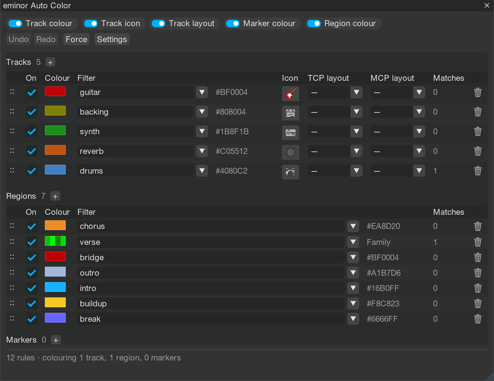

# eminor Auto Color

A replacement for SWS Auto Color/Icon/Layout, written as Lua ReaScripts.
It colours tracks, markers and regions, and sets track icons and layouts,
by rules you set. It leaves changes you make by hand alone.



Status: **phase 4**. Everything SWS Auto Color/Icon/Layout does works,
rules are edited in the editor window, and Settings › SWS imports SWS's
rules and switches SWS's own Auto Color off. Polish comes in phase 5;
see the plan doc.

## Actions

Load each with Action List › New action › Load ReaScript.

| Script | What it does |
| --- | --- |
| `eminor_autocolor_engine.lua` | Starts the background engine; run again to stop it. Shows on/off on toolbars. |
| `eminor_autocolor_editor.lua` | Opens the rule editor; run again to close it. Needs ReaImGui 0.10+ (ReaPack). |
| `eminor_autocolor_force.lua` | Applies every rule now, overwriting hand-set colours, as one undo point. |
| `eminor_autocolor_toggle_track_colour.lua` | Turns automatic track colouring on or off. |
| `eminor_autocolor_toggle_track_icon.lua` | Turns automatic track icons on or off. |
| `eminor_autocolor_toggle_track_layout.lua` | Turns automatic TCP/MCP layouts on or off (off at first, as in SWS). |
| `eminor_autocolor_toggle_marker_colour.lua` | Turns automatic marker colouring on or off. |
| `eminor_autocolor_toggle_region_colour.lua` | Turns automatic region colouring on or off. |
| `eminor_autocolor_toggle_timing_log.lua` | Prints how much UI time the engine uses to the console every 10 s. Off again after a restart. |

All toggles show on/off on toolbars.

To start the engine with REAPER, tick Settings › Startup in the editor.
Or add this line to `<resource folder>/Scripts/__startup.lua` yourself,
using the command ID the Action List shows for the engine script
(right-click › Copy selected action command ID):

```lua
reaper.Main_OnCommand(reaper.NamedCommandLookup("_RS..."), 0)
```

## The editor

Rules are grouped into Tracks, Regions and Markers, each in its own
priority order (top wins), and edited in place:

- **Drag** a row's `::` grip to reorder it, or select a row and press
  Alt+Up / Alt+Down. Right-click the grip to duplicate, move or delete.
- **Tick** a rule to turn it on or off without deleting it.
- **Click the swatch** for colours: saved palettes and colours in use
  first, "Custom colour…" for the full picker. Family colours have a
  Range / Palette toggle with hue and lightness sliders and a preview.
- **Type the filter**, or pick a special filter from the arrow menu.
- **Click the icon** for a browser over `Data/track_icons` (subfolders
  included). TCP and MCP menus list the current theme's layouts.
- The number on the right is how many items the filter matches now.

Every change is saved at once and the engine applies it straight away.
Cmd+Z and Cmd+Shift+Z (or the Undo and Redo buttons) undo rule edits.
The pills along the top are the same five switches as the toggle
actions. Settings holds the engine's fallback check interval, the icon
thumbnail size, and "Start the engine with REAPER", which adds or removes
one line in `Scripts/__startup.lua`.

Settings › SWS has SWS's own five Auto Color switches (leave them off:
SWS and this script would undo each other's colours) and **Import rules
from SWS…**, which adds SWS's rules after yours (leaving out ones with a
type and filter you already have) or replaces yours. The import changes
your rules at once, and Undo in the editor takes it back. The footer
warns while SWS is switched on for something this script also does.

## Rules

Rules live in `<resource folder>/Data/eminor_autocolor/rules.lua`, outside
this repository. The first time the engine runs it creates the file,
copying your SWS rules from `sws-autocoloricon.ini` if there are any.
The editor writes it; hand edits also work and are picked up within two
seconds. The format is described at the top of `lib/rules.lua`.

Matching follows SWS:

- A name filter matches when the name **contains** it, ignoring case
  (`gtr` matches `Bass Gtr DI`). There are no wildcards.
- Special filters in brackets match track properties: `(any)`,
  `(unnamed)`, `(folder)`, `(children)`, `(receive)`, `(master)`,
  `(record armed)`, `(vca master)`, `(instrument)`, `(audio input)`,
  `(audio output)`, `(MIDI input)`, `(MIDI output)`.
- Marker and region rules understand `(any)` and `(unnamed)`.
- Within a target, the first matching rule wins. Colour, icon, TCP layout
  and MCP layout are settled separately: a rule that only names an icon
  leaves the colour to the rules below it.
- A layout of `(hide)` hides the track in that panel instead.
- Icons are named relative to `<resource folder>/Data/track_icons`.

Colour modes: `fixed`, `gradient`, `family` (similar shades from a range
or a palette), `random` (stable per track), `parent`, `none` and
`ignore`.

## Changes you make by hand

Each track, marker and region remembers what the engine last set on it
(tracks in the track, markers and regions in the project). The engine
only changes what is still as it left it, and undoes its own changes
when a rule stops matching. Force overwrites everything.

Two cases are taken over on first sight, so moving from SWS is smooth:

- a track whose colour is exactly one a fixed rule gives;
- a marker or region that a rule matches (SWS recoloured those on every
  pass, so any colour on them came from SWS).

Tracks SWS coloured with a gradient or random colour can't be told
apart from hand colours. Run Force once to take them over.

Unlike SWS, a colour you set by hand on a marker or region now stays.

## Performance

The engine runs on REAPER's UI thread, never the audio thread. Most ticks
only compare a change counter and return. It looks at the tracks only
when the project changes (or every half second as a fallback), never
applies while recording, and waits 300 ms after Play, Record or Stop.
To check the cost on your own projects, turn on the timing log.

## Tests

The logic that doesn't need REAPER is tested with plain Lua 5.4:

```sh
lua scripts/eminor_autocolor/tests/run.lua
```

`tests/fake_reaper.lua` stands in for the REAPER API in those tests, and
`tests/fake_imgui.lua` for ReaImGui: it knows the real argument counts of
every ReaImGui 0.10 function the editor calls, so a wrong name or call
fails the tests. It can't show how the window looks.
Anything that touches REAPER for real still needs checking in REAPER.
